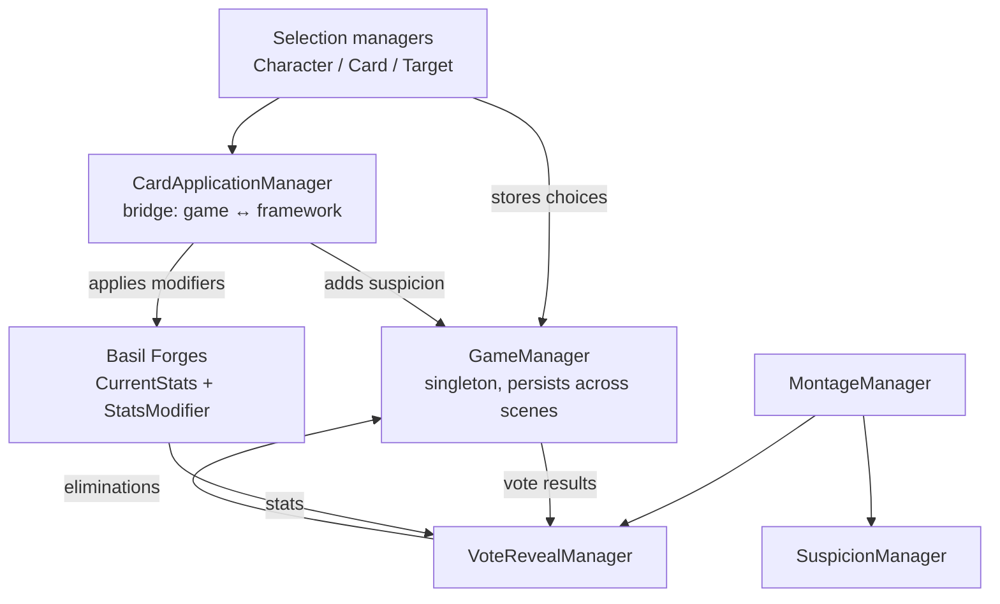

# Basil Forges

A lightweight Unity framework for building and tuning probability-based reward systems, plus **The Perfect Contestant**, the game I made to prove it actually works.

> Final Year Project (TP075060). Unity 2022.3.58f1, C#.

## Why I made this

Normally if a designer wants to tweak a probability value, a programmer has to find the hard-coded number, change it, recompile and rebuild. For a number. That slows everything down, and reward systems end up shipping half-tuned. The existing tools I looked at are either too narrow (quest systems, daily streaks) or need a server (like FORGE, from the literature review), which is a lot for a small team.

So Basil Forges keeps the stat data and the modifier logic separate from the game code. Change the data, not the gameplay scripts.

I also surveyed game dev students to check this was a real problem: **69.3%** said they constantly tweak numbers by hand, **80.8%** thought code-free config would save time, and **61.5%** wanted reward-testing tools.

## The framework

It's two reusable, game-agnostic components (`Scripts/Basil Forges/`):

| Component | What it does |
|---|---|
| `CurrentStats` | Reads stat definitions from a JSON file in `StreamingAssets` (using Unity's `JsonUtility`) and generates randomised starting values for each entity. |
| `StatsModifier` | Holds a list of modifiers (`statTarget`, `modifyAmount`, `Add` or `Subtract`) and applies them to the `CurrentStats` on the same GameObject, matching by stat name. |

**Config format** (`DefaultStats.txt`):

```json
{
  "defaultStats": [
    { "statName": "Stat 1", "statAmount": 100 }
  ]
}
```

**How starting values get rolled** (`CurrentStats.ReadFile`, in steps of 5):

- 80% of the time: middle range, 40 to 70
- 20% of the time: extreme, split 50/50 between low (0 to 35) and high (75 to 100)

Heads up: the JSON gives the stat names and structure, but the ranges above are hard-coded in `CurrentStats`, and the JSON's `statAmount` values get overwritten at runtime.

**Using it in your own project:** put `CurrentStats` and `StatsModifier` on a GameObject, add a `DefaultStats.txt`, then add `StatsModify` entries whenever you want stats to change at runtime.

## The game: The Perfect Contestant

You play a corrupt reality-TV producer who backs one of five contestants. Each one has hidden stats: **Audience Appeal, Talent, Toxicity, TV Potential**. Every round you play a **sabotage card** on a contestant, and every card pushes up a **Network Suspicion** meter. Suspicion ticks down by 10 each round (`SuspicionManager.tickDownAmount`), and if it hits **150** you're caught and the run ends. The number of rounds comes from `GameManager.maxRounds` (default 5).

Each card is a `Card` component (`targetsChosenCharacter`, `targetStat`, `modifyAmount`, `modifyOperator`, `suspicionAmount`) set up in the Unity Inspector. They all go through `StatsModifier`, which was the whole point: every game mechanic is just a data-driven modifier.

| Card | Suspicion cost (set per card in the Inspector; values from my project report) |
|---|---|
| Vote Bot (stealth mission) | 40 |
| Bad Edit | 40 |
| Coaching Session | 30 |
| Shadow Cut | 30 |
| Sympathy Arc | 20 |
| Redirect | 20 |

**How a round gets resolved**

```
VoteScore = Random.Range(70, 95) + AudienceAppeal + Talent - Toxicity   (CardApplicationManager)
Payout    = (TVPotential * (1 - Toxicity / 100)) * 50000                (GameManager)
```

Integer `Random.Range` leaves out the upper number, so the base roll is 70 to 94. Lowest vote score gets eliminated. To win you need to stay undetected, your contestant has to win, **and** they need to have the highest possible payout.

## How it fits together



### Main scripts

| Script | What it does |
|---|---|
| `GameManager` | Singleton (`DontDestroyOnLoad`) that holds all the global state: round, chosen and targeted contestant, selected card, suspicion, eliminations, vote and payout results, and each contestant's playlist. Playlists get shuffled with a Fisher-Yates shuffle so songs don't repeat in the same order. |
| `CardApplicationManager` | The bridge between the game and the framework. Applies the card's modifier to the chosen contestant (help cards) or the targeted one (harm cards), adds suspicion, works out every remaining contestant's vote score and payout (stored in `GameManager`), then loads the right scene for that card. Ends the run at suspicion ≥ 150. |
| `MontageManager` | Runs the performances and camera switching (never the same camera twice in a row). Handles the Bad Edit camera swap and Shadow Cut, and ticks suspicion down each montage. |
| `VoteRevealManager` | Reads results from `GameManager`, animates the vote bars, highlights the lowest scorer, and works out win, almost-win, pass or caught. |
| `SuspicionManager` | Runs the suspicion slider and the per-round tick-down. |
| `GuardDetection` / `GuardRotation` | The stealth part. Guards sweep between two angles and check distance plus a view cone (defaults: 5 unit radius, 60° cone) to start a chase, and give up past a set radius. |
| `PlayerMovement` | Rigidbody-velocity movement with mouse look and clamped camera pitch. Stops when `Time.timeScale == 0`. |

The rest: `CharacterSelectionManager`, `CardSelectionManager`, `TargetSelectionManager`, `SympathyArcManager`, `CoachingManager`, `RedirectManager`, `VoteBotManager`, `PauseManager`, `MenuManager`, `TutorialManager`.

## Project structure

```
Assets/Scripts/
├── Basil Forges/     # the reusable framework (Probability/, JSON/)
├── Game/             # Card, Contestants, Managers, Player, TV, Triggers, GameManager
└── Testing/
```

## How I built it

Agile, in two-week sprints, with the framework and the game being built side by side. That way every framework feature got tested in the game straight away.

## Testing and results

_These results are from the build in my project report. The scripts have been updated since._

- **Unit tests:** 21 functional tests across menu, tutorial, producer office, character/card/target selection, montage and vote results. All passed.
- **User acceptance testing:** 7 players, about 30 minutes of play each, then a 22-question questionnaire.

| What I measured | Result |
|---|---|
| Gameplay loop engagement | 57.1% gave 4/5, 42.9% gave 3/5 |
| Voting fairness | 71.4% "A Bit Random but Fun", 28.6% "Fair but Fun", 0% "Out of Control" |
| Pacing | 71.4% "Well Balanced", 28.6% "Too Slow" |
| Difficulty | 57.1% "Fairly Hard", 42.9% "Very Hard" |
| Overpowered strategy reported | None |

## Known limitations

- Balance isn't final. The random vote range is still being tuned.
- `WeightCalculator` (an alternative 80 to 90 vote calculation) is in the scripts but nothing else calls it, so the real vote logic lives in `CardApplicationManager`.
- Feedback on presentation: camera stability, no audio settings menu yet, and the tutorial needs work.
- Only 7 testers, and none of them were developers. Small sample.
- Unity and C# only, and only tried on an elimination-style game so far.

## What's next

- A bigger test group, including developers who'll actively try to break the suspicion system.
- Try the framework on a different genre.
- Improve the UI and tutorial.

## License

_Add a license here._
